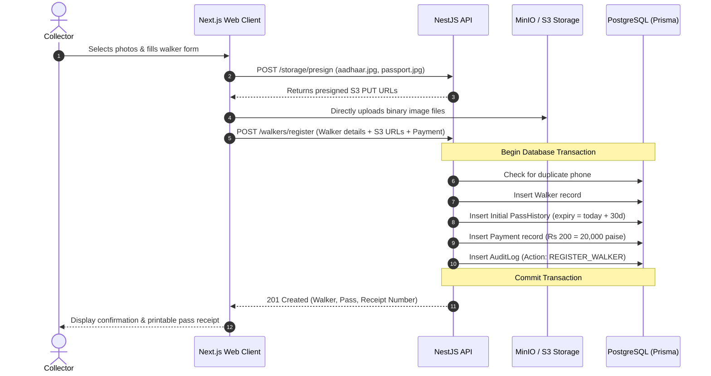

# System Architecture & Technical Specifications

## 1. Overview & Monorepo Structure

Walker Pass Desk is designed as a modular monorepo utilizing **pnpm workspaces** and **TypeScript Project References**.

```
park/
├── apps/
│   ├── api/                           # Backend REST Service (NestJS)
│   │   ├── prisma/
│   │   │   ├── schema.prisma          # Database models, indices, enums
│   │   │   └── migrations/            # Committed relational schema migrations
│   │   └── src/
│   │       ├── common/                # Envs, filters, pipes, guards, interceptors
│   │       │   ├── env.ts             # Zod environment variable validation
│   │       │   ├── filters/           # Global exception filter ({ code, message, details })
│   │       │   └── pipes/             # ZodValidationPipe
│   │       ├── modules/
│   │       │   ├── auth/              # JWT issuance, bcrypt verification, role guards
│   │       │   ├── walkers/           # Registration, renewal, search, soft delete
│   │       │   ├── payments/          # Payment creation, immutable audit, receipt generation
│   │       │   ├── storage/           # S3 presigned URL generation, file constraints
│   │       │   └── reports/           # Admin aggregation metrics, gate collections, CSV export
│   │       └── main.ts                # App bootstrapper with helmet, rate-limit, CORS
│   │
│   └── web/                           # Frontend Desk Interface (Next.js 15)
│       └── src/
│           ├── app/                   # App Router pages (login, dashboard, register, renew, reports)
│           ├── components/            # UI components (shadcn/ui primitives, scanner, pass card)
│           └── lib/                   # API client, session management, formatters
│
├── packages/
│   └── shared/                        # Shared contracts, schemas, business logic
│       └── src/
│           ├── constants.ts           # GATES, USER_ROLES, PASS_STATUS, PASS_CONFIG
│           ├── schemas.ts             # Zod schemas for input validation and API contracts
│           ├── business-rules.ts      # Expiry logic, fee calculation, status calculations
│           └── index.ts
│
├── docs/
│   └── ARCHITECTURE.md                # System Architecture & Technical Specifications
├── docker-compose.yml                 # Local PostgreSQL 16 & MinIO object store
└── package.json                       # Monorepo root workspace definition
```

---

## 2. API Modules & Responsibilities

### 2.1 Auth Module (`/auth`)

- **Endpoints**:
  - `POST /auth/login`: Authenticates staff (username/password), returns signed JWT token with user role and permitted gates.
  - `GET /auth/me`: Returns caller profile and session state.
- **Security**: Passwords hashed with bcrypt (salt rounds = 12). Tokens expire in 12 hours.

### 2.2 Walkers Module (`/walkers`)

- **Endpoints**:
  - `GET /walkers/search`: Fast search by phone number, pass number, or name. Collectors and Admins.
  - `POST /walkers/register`: Register new walker. Requires Aadhaar document URL, passport photo URL, initial payment details.
  - `POST /walkers/:id/renew`: Renew walker pass for 30 days. Requires renewal ticket photo URL and payment mode.
  - `GET /walkers/:id`: Walker detail including active pass status and pass history.
  - `PATCH /walkers/:id`: Admin only edit walker metadata.
  - `DELETE /walkers/:id`: Admin only soft delete (sets `isDeleted: true`, `deletedAt`, `deletedReason`).

### 2.3 Payments & Receipts Module (`/payments`)

- **Endpoints**:
  - `GET /payments/receipt/:receiptNumber`: Public or staff verification receipt endpoint.
  - `GET /payments/my-shift`: Collector shift summary (total cash and UPI collected for current gate).
- **Rule**: Payments are strictly **immutable**. No update or delete operations are exposed or implemented.

### 2.4 Storage Module (`/storage`)

- **Endpoints**:
  - `POST /storage/presign`: Issues secure presigned PUT URLs for document upload.
  - Requires authenticated session. Enforces allowed MIME types (`image/jpeg`, `image/png`, `application/pdf`) and max file size (5MB).
  - Client uploads directly to private S3/MinIO bucket.

### 2.5 Reports & Admin Module (`/reports`)

- **Endpoints**:
  - `GET /reports/summary`: Daily and monthly revenue, pass counts by gate (G2, GS, G9), payment mode split.
  - `GET /reports/expiries`: Expiry radar showing passes expiring in next 7 days.
  - `GET /reports/export`: Admin-only CSV export with date range filtering.

---

## 3. Data Flow & Transaction Management

All financial and state-changing pass operations execute within strict **Prisma interactive database transactions** (`prisma.$transaction`):



---

## 4. Authentication & Role-Based Access Control (RBAC)

The system defines 3 distinct roles:

1. **SUPER_ADMIN**: Full access across all gates, users, reports, database operations, and system configurations.
2. **ADMIN**: Full operational access: walker edits, soft deletes, phone duplicate overrides, report generation, exports, and staff management.
3. **COLLECTOR**: Gate operational access: search walkers, register new walkers, renew existing passes, issue printed receipts, and view personal shift collection totals. Cannot edit walker records, cannot soft-delete, cannot access financial exports or user management.

### Authorization Guard Pipeline

```
Request
  ──> RateLimiter (ThrottlerGuard)
  ──> JwtAuthGuard (Validates Bearer token)
  ──> RolesGuard (Validates @Roles([UserRole...]))
  ──> ZodValidationPipe (Validates and sanitizes body/query)
  ──> Controller Handler
```

---

## 5. File Upload Flow (Secure Presigned S3 URLs)

To prevent file payload bottlenecks on the application server and ensure isolation:

1. Staff requests an upload URL with file metadata (`fileName`, `fileType`, `fileSize`).
2. API validates file type (JPEG, PNG, WebP) and maximum size (<= 5 MB).
3. API signs a time-limited S3 PUT URL (valid for 5 minutes) targeted at bucket path `documents/{walkerId|temp}/{uuid}.ext`.
4. Browser executes `PUT` directly to S3.
5. On form submit, the confirmed S3 resource key/URL is sent to the API, which records it in the database.

---

## 6. Error Handling Strategy & Error Contract

All HTTP responses in failure scenarios strictly conform to the non-negotiable contract:

```json
{
  "code": "VALIDATION_ERROR",
  "message": "Invalid request payload",
  "details": [
    {
      "field": "phone",
      "message": "Must be a valid 10-digit Indian mobile number"
    }
  ]
}
```

### Sanitization & Safety

- **No SQL Leaks**: `PrismaClientKnownRequestError` is caught by `AllExceptionsFilter` and mapped to domain error codes (e.g., `CONFLICT_ERROR` for unique key violations). Raw SQL queries and table constraints are never sent to the client.
- **No Stack Traces**: Stack traces are logged server-side via NestJS `Logger` with request correlation, but the client response body remains cleanly sanitized.

---

## 7. Logging & Auditing

1. **Structured Operational Logs**: Application errors, startup events, and external service connection failures log structured JSON.
2. **Immutable Audit Table (`audit_logs`)**:
   - Every financial state change (Registration, Renewal) records:
     - `actorId` (Collector/Admin ID)
     - `action` (`REGISTER_WALKER`, `RENEW_PASS`, `OVERRIDE_PHONE`, `SOFT_DELETE`)
     - `entityType` (`Walker`, `Payment`)
     - `entityId`
     - `details` (JSON snapshot of changes and metadata)
     - `createdAt` (UTC timestamp)

---

## 8. Environments & Configuration

| Variable       | Development (Local)                     | Staging / Production                      |
| -------------- | --------------------------------------- | ----------------------------------------- |
| `NODE_ENV`     | `development`                           | `production`                              |
| `DATABASE_URL` | `postgresql://...` (Local Docker)       | Managed PostgreSQL (e.g. RDS / Cloud SQL) |
| `S3_ENDPOINT`  | `http://localhost:9000` (MinIO)         | `https://s3.<region>.amazonaws.com`       |
| `S3_USE_SSL`   | `false`                                 | `true`                                    |
| `CORS_ORIGIN`  | `http://localhost:3000`                 | Restricted park production domain         |
| `TIMEZONE`     | Enforced in app display: `Asia/Kolkata` | `Asia/Kolkata`                            |
