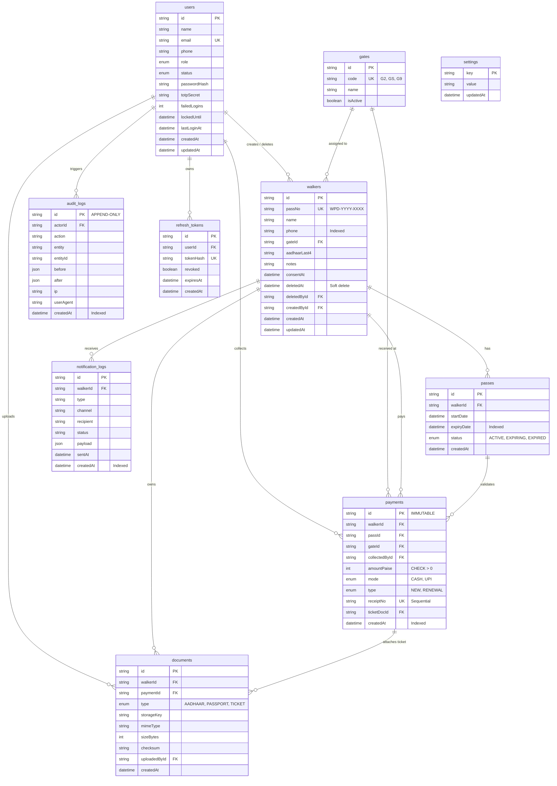

# Database Design & Relational Specifications

## 1. Entity Design Decisions (1-2 Lines Per Table)

1. **`users`**:
   Stores park staff and administrators with granular roles (`SUPER_ADMIN`, `ADMIN`, `COLLECTOR`), supporting account lockouts (`failedLogins`, `lockedUntil`) and future 2FA TOTP secrets.
2. **`gates`**:
   Enumerates physical entry checkpoints (`G2`, `GS`, `G9`) allowing operational gating and revenue attribution per location.
3. **`walkers`**:
   Maintains core walker profiles with soft-delete capabilities (`deletedAt`, `deletedById`) to protect member historical continuity without data loss.
4. **`passes`**:
   Represents time-bounded 30-day park access intervals, allowing multi-pass historical tracking per walker with instant status indices.
5. **`payments`**:
   Records immutable financial transactions in integer paise with annual sequential receipt numbers; strictly blocks any `UPDATE` or `DELETE` at the database trigger level.
6. **`documents`**:
   Tracks private S3 object keys, MIME types, and SHA-256 integrity checksums for Aadhaar identity proofs, passport photos, and renewal tickets.
7. **`settings`**:
   Stores dynamic, operational parameters (e.g., standard pass fee of 20,000 paise, 30 days validity, 7-day expiration alert window) without hardcoding business constants.
8. **`audit_logs`**:
   Provides an immutable, append-only security ledger capturing actor IDs, state snapshots (`before`/`after`), client IPs, and user agents for every financial or administrative modification.
9. **`refresh_tokens`**:
   Secures long-lived JWT session rotations with hashed tokens and explicit revocation states.
10. **`notification_logs`**:
    Records SMS/WhatsApp reminder dispatches for expiring passes to prevent duplicate messaging and trace communication reliability.

---

## 2. Integrity & Constraint Protections

- **CHECK Constraints**:
  - `chk_payments_amount_positive`: `CHECK ("amountPaise" > 0)` ensures zero or negative values cannot be inserted.
  - `chk_passes_expiry_after_start`: `CHECK ("expiryDate" > "startDate")` guarantees temporal validity.
- **Database-Level Immutability**:
  - `trg_payments_immutable`: PostgreSQL `BEFORE UPDATE OR DELETE` trigger aborts any attempt to modify or delete completed payments.
  - `trg_audit_logs_immutable`: PostgreSQL `BEFORE UPDATE OR DELETE` trigger protects the audit ledger against tampering.
- **Indexes**:
  - High-traffic lookup indexes on `walkers(phone)`, `walkers(passNo)`, `passes(expiryDate)`, `payments(createdAt)`, `payments(gateId)`, and `audit_logs(createdAt)`.

---

## 3. Entity-Relationship Diagram (ERD)

